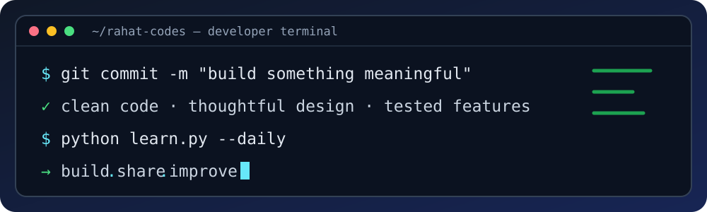
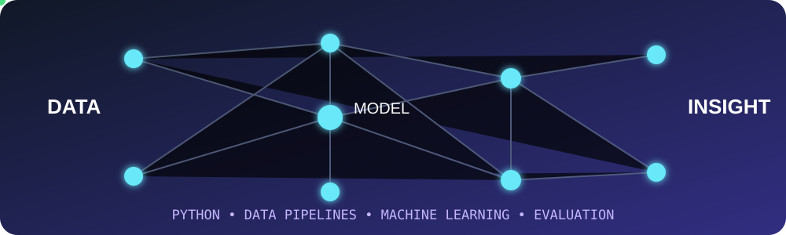
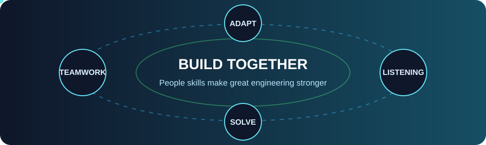
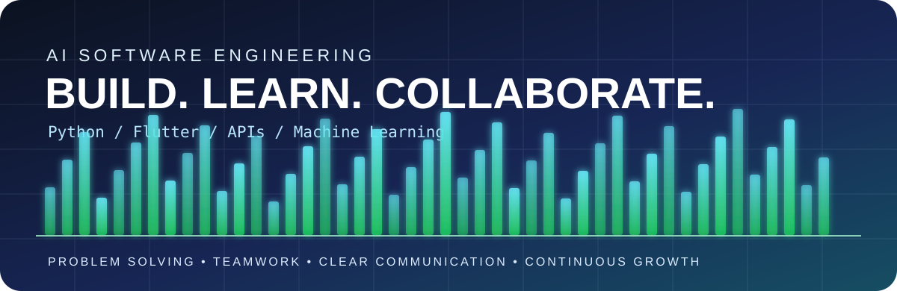

<!--
  GitHub Profile README
  Repository: https://github.com/rahat-codes/rahat-codes
  Animated title uses readme-typing-svg. If the external service is unavailable,
  the static heading below still communicates the profile focus.
-->

# RAHAT MD MAHADI HASSAN

**AI SOFTWARE ENGINEERING · APPLIED MACHINE LEARNING · MOBILE & BACKEND DEVELOPMENT**

Building practical software. Solving real problems. Growing through collaboration.

  
  
  
  

  <b>AI Software Engineering Student</b> · Backend & Mobile Development · Applied Machine Learning

  <a href="#-featured-projects">Projects</a> ·
  <a href="#-engineering-toolkit">Tech Stack</a> ·
  <a href="#-animated-developer-showcase">Animations</a> ·
  <a href="#-current-focus">Current Focus</a> ·
  <a href="#-connect">Contact</a>

---

## 👨‍💻 About Me

I'm an AI student focused on **building useful software systems**—from mobile and backend applications to data-driven and machine-learning solutions.

I approach projects with an engineering mindset: clarify the problem, break it into manageable components, design clear interfaces, test important behavior, document trade-offs, and use AI where it creates measurable value.

- 🎯 **Career direction:** AI Software Engineer / Software Engineer
- 🧱 **Software engineering:** backend services, REST APIs, modular architecture, databases, and testing
- 📱 **Product development:** Flutter and Dart applications
- 🤖 **Applied AI:** machine learning workflows, model evaluation, and reproducible experiments
- 🤝 **Ways of working:** communication, teamwork, active listening, adaptability, and continuous learning
- 🌱 **Currently improving:** production-quality code, deployment workflows, and collaborative development

### Portfolio at a glance

| Focus | What you'll find |
|---|---|
| Application engineering | Flutter apps, navigation, state management, and user-facing features |
| Backend engineering | Python services, API design, persistence, and integration |
| Applied machine learning | Data preparation, model training, evaluation, and inference workflows |
| Research & reproducibility | Validation strategy, experiment design, and transparent limitations |

## 🧰 Engineering Toolkit

  

| Area | Tools and concepts |
|---|---|
| Languages | Python, Dart, C, C++ |
| Backend | FastAPI, Flask, REST API development |
| Mobile | Flutter, GoRouter, Riverpod |
| Data | Pandas, NumPy, SQLite, PostgreSQL |
| Machine learning | scikit-learn, TensorFlow, CatBoost, XGBoost |
| Engineering | Modular design, layered architecture, Git, Docker |
| Quality | pytest, Flutter tests, static analysis, cross-validation |

*This toolkit reflects technologies represented in my repositories and learning projects. It does not imply equal production experience with every tool.*

---

## 🚀 Featured Projects

These projects demonstrate different parts of the software engineering lifecycle: application architecture, backend services, data pipelines, model evaluation, and mobile development.

<table>
  <tr>
    <td width="50%" valign="top">
      <h3>🧭 <a href="https://github.com/rahat-codes/campusar">CampusAR</a></h3>
      
<b>Offline-first campus navigation</b>

      
Flutter mobile client with a Python FastAPI backend, local SQLite persistence, A* pedestrian routing, API layers, database migrations, Docker setup, and backend tests.

      
Flutter · Dart · FastAPI · PostgreSQL · SQLite · A*

    </td>
    <td width="50%" valign="top">
      <h3>💳 <a href="https://github.com/rahat-codes/nova_fintech">Nova Fintech</a></h3>
      
<b>Modular fintech mobile application</b>

      
Flutter application organized into app, core, data, and feature areas, using GoRouter for navigation and Riverpod for state-management foundations.

      
Flutter · Dart · Riverpod · GoRouter

    </td>
  </tr>
  <tr>
    <td width="50%" valign="top">
      <h3>🎓 <a href="https://github.com/rahat-codes/mlproject">Student Performance Prediction</a></h3>
      
<b>End-to-end ML application</b>

      
Python regression workflow covering data ingestion, preprocessing, model comparison, serialized artifacts, and a Flask prediction interface.

      
Python · Pandas · scikit-learn · Flask

    </td>
    <td width="50%" valign="top">
      <h3>🧪 <a href="https://github.com/rahat-codes/automotive-classification-reproducible-project">Automotive Classification Research</a></h3>
      
<b>Reproducible model evaluation</b>

      
Research-oriented comparison of vehicle-type classifiers, with leakage-aware pipelines, repeated cross-validation, baselines, external validation, and statistical methodology audits.

      
Python · scikit-learn · Model evaluation · Statistics

    </td>
  </tr>
  <tr>
    <td width="50%" valign="top">
      <h3>🗺️ <a href="https://github.com/rahat-codes/free_campus_map">Free Campus Map</a></h3>
      
<b>Location-aware Flutter prototype</b>

      
Interactive map, OpenStreetMap place discovery, device geolocation, and walking-route requests through external services.

      
Flutter · Dart · OpenStreetMap · Geolocation

    </td>
    <td width="50%" valign="top">
      <h3>🏍️ <a href="https://github.com/rahat-codes/moto-travel">Moto Travel</a></h3>
      
<b>Mobile game prototype</b>

      
Flutter motorcycle-riding prototype featuring motorcycle selection, movement controls, acceleration, braking, and obstacle avoidance.

      
Flutter · Dart · Interactive UI

    </td>
  </tr>
</table>

> **Data transparency:** CampusAR currently includes fictional illustrative campus data, not verified university building information. Check each repository's README for project status, setup requirements, and limitations.

## 🏗️ My Engineering Principles

1. **Design before adding complexity** — keep responsibilities separated and code understandable.
2. **Build reliable interfaces** — validate inputs and handle API, network, and permission failures.
3. **Make experiments reproducible** — document datasets, preprocessing, splits, metrics, and random seeds.
4. **Test important behavior** — use unit, integration, and widget tests where appropriate.
5. **Document for other developers** — provide setup instructions, architecture, limitations, and examples.
6. **Measure instead of guessing** — report model performance only when backed by repeatable evaluation.

## ✨ Animated Developer Showcase

<table>
  <tr>
    <td width="50%" valign="top">
      
    </td>
    <td width="50%" valign="top">
      
    </td>
  </tr>
</table>

Four original SVG animations: coding workflow, AI/data flow, collaboration and soft skills, and continuous engineering growth. SVG animation support can vary by GitHub client.

---

## 🐍 Contribution Animation

## 📈 GitHub Activity

## 🎯 Current Focus

- Strengthening software design, backend engineering, API development, and database fundamentals.
- Building complete applications with clear architecture, useful documentation, and meaningful tests.
- Improving model evaluation, reproducibility, and practical AI integration.
- Practicing collaborative engineering through readable commits, issue tracking, and code review habits.
- Preparing for AI Software Engineer and Software Engineer internship opportunities.

### What I value as a teammate

**Clear communication · Thoughtful problem-solving · Reliable follow-through · Openness to feedback · Continuous learning**

## 🤝 Connect

I'm open to learning, collaboration, and conversations about software engineering, applied AI, machine learning, and useful technology.

- GitHub: [@rahat-codes](https://github.com/rahat-codes)
- LinkedIn: [Rahat Md Mahadi Hassan](https://www.linkedin.com/in/rahat-md-mahadi-hasan/)

---

**Thanks for stopping by. Explore a repository, inspect the implementation, and feel free to connect!** ✨

