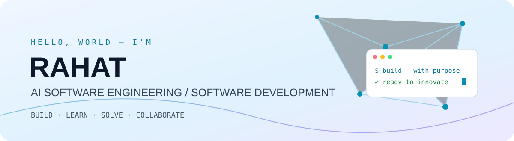

<!-- THEME-AWARE HERO -->
<picture>
  <source media="(prefers-color-scheme: dark)" srcset="https://raw.githubusercontent.com/rahat-codes/rahat-codes/main/assets/profile-hero-dark.svg">
  <source media="(prefers-color-scheme: light)" srcset="https://raw.githubusercontent.com/rahat-codes/rahat-codes/main/assets/profile-hero-light.svg">
  
</picture>

---

## About

I'm an AI student interested in **software engineering, applied machine learning, and building practical products**. I enjoy turning ideas into working applications, learning through experimentation, and collaborating to solve real problems.

- **Focus:** AI Software Engineering · Backend Development · Mobile Applications
- **Languages:** Python · Dart · C · C++
- **Tools:** Flutter · FastAPI · Flask · TensorFlow · scikit-learn · Git
- **Currently improving:** application architecture, API development, ML evaluation, and end-to-end engineering
- **Team strengths:** problem-solving · communication · teamwork · adaptability · continuous learning

## Tech Stack

## GitHub Statistics

 

## Selected Projects

| Project | What it demonstrates |
|---|---|
| [CampusAR](https://github.com/rahat-codes/campusar) | Flutter campus navigation prototype, FastAPI backend, routing and local persistence |
| [Nova Fintech](https://github.com/rahat-codes/nova_fintech) | Modular Flutter fintech application and modern mobile UI |
| [Student Performance Prediction](https://github.com/rahat-codes/mlproject) | Python ML workflow, preprocessing, model comparison and prediction interface |
| [Automotive Classification Research](https://github.com/rahat-codes/automotive-classification-reproducible-project) | Reproducible machine-learning evaluation and validation methodology |
| [Free Campus Map](https://github.com/rahat-codes/free_campus_map) | Flutter mapping, geolocation and walking-route prototype |
| [Moto Travel](https://github.com/rahat-codes/moto-travel) | Interactive motorcycle game prototype built with Flutter |

Project descriptions are brief summaries. Check each repository for implementation details, current status, and limitations.

## Engineering Focus

- Designing maintainable software with clear module boundaries
- Building and testing backend APIs and database-backed applications
- Developing practical ML workflows with reproducible evaluation
- Writing useful documentation and collaborating through Git and code reviews

## Connect

**Thanks for visiting — explore my repositories and feel free to connect!**

